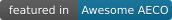
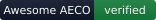
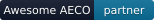

# Awesome AECO Brand Kit

Official logos, color tokens, OpenGraph social preview assets, and embeddable badges for **Awesome AECO**.

> **Important:** All assets in this directory are governed by [TRADEMARK.md](../TRADEMARK.md) and are **excluded** from the CC0 1.0 dedication that applies to `readme.md`.

---

## Color Palette

| Token | Hex | Role |
| --- | --- | --- |
| **Blueprint Blue** | `#0B6E99` | Primary brand color, links, badges |
| **Drafting Cyan** | `#38BDF8` | Dark-mode accent, highlights, wireframe details |
| **Structural Navy** | `#0F172A` | Primary dark surface, light-mode headings |
| **Slate Concrete** | `#475569` | Secondary text, subtle labels |
| **Paper Light** | `#F8FAFC` | Light surface background, inverted text |
| **Hairline Grid** | `#E2E8F0` | Dividers, borders, subtle grid lines |
| **Verified Green** | `#15803D` | `Awesome AECO: verified` badge accent |

---

## Logos & Social Assets

| Asset | File | Intended Use |
| --- | --- | --- |
| Square Icon (SVG) | [`icon.svg`](icon.svg) | Editable vector icon, favicons (`512×512`) |
| Square Icon (PNG) | [`icon.png`](icon.png) | GitHub Organization avatar and raster app icons (`512×512`) |
| Light Wordmark | [`logo-light.svg`](logo-light.svg) | Light backgrounds, documentation headers, slides |
| Dark Wordmark | [`logo-dark.svg`](logo-dark.svg) | Dark backgrounds, terminal/dev docs, dark themes |
| OpenGraph Card (SVG) | [`og-card.svg`](og-card.svg) | Editable vector source (`1200×630`) |
| OpenGraph Card (PNG) | [`og-card.png`](og-card.png) | GitHub social preview, LinkedIn/X/Slack OpenGraph meta tag (`1200×630`) |

---

## Embeddable Badges

### Featured in Awesome AECO *(Open to any listed project)*



```markdown
[](https://github.com/awesome-aeco/Awesome-AECO)
```

*(Note: `badges/featured-in-awesome-aeco.svg` is retained at its original path for backward compatibility alongside `brand/badges/featured.svg`.)*

### Awesome AECO Verified *(Requires maintainer approval)*



### Awesome AECO Partner *(Requires maintainer approval)*


